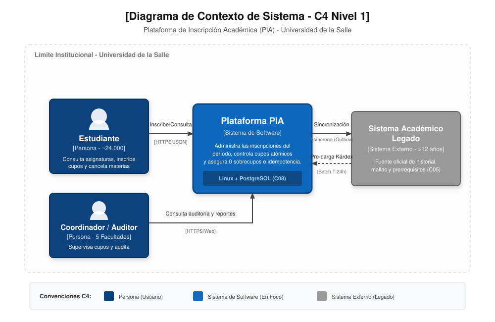
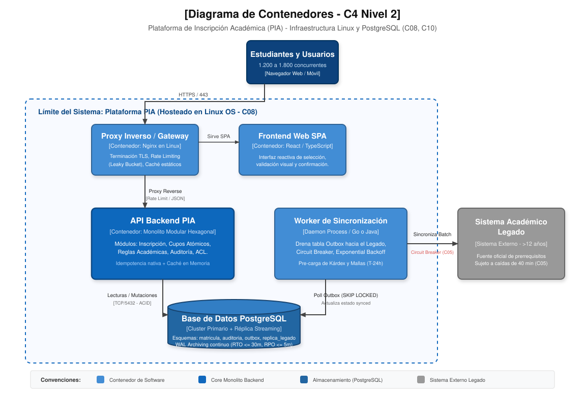

> **Estudiante:** David Mauricio Pérez Cordero | **Documento:** xxxxxxxx2

# Actividad 2. Diseño de la Estructura Arquitectónica
## Plataforma de Inscripción Académica (PIA) - Universidad de la Salle

---

## 1. Selección y Justificación del Estilo Arquitectónico

### 1.1. Estilo Seleccionado: Monolito Modular con Arquitectura Hexagonal (Ports & Adapters)

Para dar respuesta rigurosa a los drivers de calidad y restricciones (`C01` a `C10`), se selecciona el estilo de **Monolito Modular con Arquitectura Hexagonal interna**. 

En este enfoque, el sistema se empaqueta y despliega como un único artefacto ejecutable en Linux, pero su diseño interno está estrictamente particionado en módulos de dominio autónomos con fronteras claras y acoplamiento nulo entre sí a nivel de base de datos. Cada módulo expone puertos de entrada (casos de uso) y puertos de salida (persistencia, mensajería, auditoría e integraciones), aislados mediante adaptadores específicos.

```
+----------------------------------------------------------------------------+
|                         MONOLITO MODULAR (PIA API)                         |
|                                                                            |
|  [ Módulo Catálogo ]    [ Módulo Inscripciones ]    [ Módulo Auditoría ]   |
|         |                       |                            |             |
|         v                       v                            v             |
|    (Puertos In)            (Puertos In)                 (Puertos In)       |
|    +----------+            +----------+                 +----------+       |
|    | Dominio  |            | Dominio  |                 | Dominio  |       |
|    +----------+            +----------+                 +----------+       |
|    (Puertos Out)           (Puertos Out)                (Puertos Out)      |
|         |                       |                            |             |
+---------+-----------------------+----------------------------+-------------+
|               INFRAESTRUCTURA Y ADAPTADORES COMPARTIDOS                    |
|   - Nginx (Reverse Proxy & Rate Limit)                                     |
|   - PostgreSQL (Límite Transaccional ACID: Schemas Matricula, Outbox, etc)|
|   - Anti-Corruption Layer (ACL) hacia Sistema Legado                       |
+----------------------------------------------------------------------------+
```

### 1.2. Análisis Comparativo de Alternativas

| Criterio de Decisión | Monolito Modular Hexagonal (Seleccionada) | Microservicios Distribuidos | Monolito en Capas Tradicional |
| :--- | :--- | :--- | :--- |
| **Sostenibilidad del Equipo (`C10`: 4 devs + 1 admin)** | **Óptima:** Una única base de código, un solo pipeline CI/CD y despliegue unificado sin sobrecarga operativa. | **Inviable:** Requiere gestión de mallas de servicios, contratos distribuidos, tracing y monitoreo avanzado. | **Buena:** Fácil de entender inicialmente, pero degrada con el tiempo. |
| **Garantía de Consistencia de Cupos (`C04`)** | **Total:** Permite transacciones ACID locales ultrarrápidas en PostgreSQL para cupo, inscripción y outbox. | **Deficiente:** Requiere transacciones distribuidas (Saga/2PC) propensas a carreras y sobrecupos. | **Aceptable:** Permite ACID local pero sufre contención si no hay diseño atómico. |
| **Costo y Restricción de Infraestructura (`C08`)** | **Mínimo:** Ejecuta directamente en Linux y PostgreSQL estándar sin brokers comerciales ni clústeres costosos. | **Alto:** Requiere orquestadores (Kubernetes), brokers dedicados y múltiples instancias de BD. | **Mínimo:** Ejecuta en una máquina Linux estándar. |
| **Aislamiento del Sistema Legado (`C05`, Esc. A)** | **Excelente:** El módulo de integración aísla el legado mediante una capa anticorrupción (ACL) y Outbox. | **Excelente:** Servicio dedicado de integración, pero agrega latencia de red innecesaria. | **Pobre:** Las capas suelen mezclarse y el modelo de datos del legado invade toda la app. |
| **Capacidad de Evolución de Reglas (`QA-05`)** | **Alta:** El dominio académico está desacoplado de la persistencia y de la API web; reglas testeables en memoria. | **Alta:** Cada microservicio evoluciona aislado, pero introduce complejidad de integración. | **Baja:** La lógica de negocio termina filtrándose en controladores o procedimientos almacenados. |

---

## 2. Modelado de Arquitectura con el Modelo C4

### 2.1. Nivel 1: Diagrama de Contexto de Sistema

El diagrama de contexto ilustra los actores humanos principales, el límite institucional de la Universidad de la Salle, la interacción con la Plataforma PIA y su dependencia con el Sistema Académico Legado.



* **Estudiante (~24.000 usuarios):** Accede durante las ventanas de matrícula para consultar cupos, inscribir asignaturas y gestionar su carga académica en tiempo real.
* **Coordinador / Auditor Académico (5 facultades):** Supervisa la ocupación de los grupos, autoriza ajustes extraordinarios y revisa la bitácora inmutable de auditoría.
* **Plataforma PIA:** Sistema centralizado que gestiona las matrículas del período activo, asegura cero sobrecupos (`C04`), absorbe la concurrencia (`C01`, `C02`) y tolera fallas del legado (`C05`).
* **Sistema Académico Legado (>12 años):** Repositorio oficial histórico. Suministra los antecedentes académicos consolidados y recibe las inscripciones en firme de forma asíncrona.

---

### 2.2. Nivel 2: Diagrama de Contenedores

El diagrama de contenedores describe la distribución de aplicaciones, servicios de soporte, mecanismos de almacenamiento y protocolos en estricto cumplimiento del stack Linux + PostgreSQL (`C08`).



* **Frontend Web SPA (React/TypeScript):** Aplicación de página única ejecutada en el navegador del cliente. Proporciona retroalimentación instantánea, valida formatos de entrada y genera llaves criptográficas de idempotencia (`UUIDv4`) por cada intento de inscripción.
* **Proxy Inverso / Gateway (Nginx sobre Linux):** Punto único de entrada seguro (HTTPS/TLS 1.3). Implementa limitación de tasa (*Rate Limiting*) mediante algoritmo *Leaky Bucket* por dirección IP y token de usuario para mitigar ráfagas abusivas (Escenario B).
* **API Backend PIA (Monolito Modular Hexagonal):** Contenedor principal de lógica de negocio. Aloja los módulos de Catálogo, Inscripción, Cupos, Auditoría y Adaptador Legado.
* **Worker de Sincronización Asíncrona (Daemon Process en Linux):** Proceso en segundo plano que implementa el patrón *Transactional Outbox*. Lee eventos pendientes de la tabla `outbox.eventos_sincronizacion` utilizando `SELECT ... FOR UPDATE SKIP LOCKED` y los transmite al Sistema Legado respetando políticas de reintento y *Circuit Breaker*.
* **Base de Datos PostgreSQL (Clúster Primario + Réplica Streaming):** Motor relacional unificado particionado en esquemas lógicos:
  * `matricula`: Almacena grupos, cupos atómicos y registros de inscripción del período.
  * `replica_legado`: Almacena la copia de solo lectura de prerrequisitos y kárdex pre-cargado.
  * `auditoria`: Bitácora inmutable append-only con firmas de no repudio.
  * `outbox`: Cola transaccional persistente de eventos de sincronización.
  * *Continuidad:* Configurada con archivado continuo de WAL (*Write-Ahead Logging*) hacia disco secundario, garantizando RTO $\le$ 30 min (`C06`) y RPO $\le$ 5 min (`C07`).

---

### 2.3. Nivel 3: Diagrama de Componentes (Módulo de Inscripciones y Cupos)

Se descompone en detalle el módulo más crítico del sistema: la gestión transaccional de inscripciones y la reserva matemática de cupos.


#### Componentes del Módulo:
1. **InscripcionController:** Controlador REST que expone los endpoints `/api/v1/inscripciones`. Valida esquemas DTO y traduce excepciones de dominio a códigos de estado HTTP estandarizados (RFC 7807).
2. **IdempotencyMiddleware:** Interceptor que captura el encabezado `Idempotency-Key`. Consulta la tabla de idempotencia; si la llave ya fue procesada, retorna inmediatamente la respuesta almacenada en caché sin invocar la capa de dominio.
3. **InscripcionAppService:** Orquestador de la transacción de aplicación. Abre la frontera transaccional `@Transactional(isolation = READ_COMMITTED)` en PostgreSQL y coordina a los servicios de dominio en estricto orden secuencial.
4. **MotorReglasAcademicas (Domain Service):** Evalúa la viabilidad académica del estudiante:
   * Verifica que las asignaturas prerrequisito estén aprobadas en la tabla `replica_legado.kardex_estudiante`.
   * Comprueba que los horarios de las clases del grupo solicitado no colisionen con materias ya inscritas por el estudiante.
   * Valida que no se exceda el límite máximo de créditos permitidos por facultad.
5. **GestorCuposAtomico (Domain Service):** Responsable de la garantía matemática de cero sobrecupos (`C04`). Ejecuta la actualización atómica condicional directamente en PostgreSQL.
6. **InscripcionRepository (Port/Adapter):** Inserta el registro de inscripción en `matricula.inscripciones` con estado inicial `INSCRITO_PENDIENTE_SINCRONIZACION_OFICIAL` y asegura la restricción de unicidad compuesta:
   ```sql
   CONSTRAINT uq_estudiante_asignatura UNIQUE (estudiante_id, asignatura_id, periodo_academico)
   ```
7. **AuditoriaService (Port/Adapter):** Inserta de forma síncrona dentro de la misma transacción el registro forense en `auditoria.trazabilidad` con datos de sesión, IP, timestamp en milisegundos y cambios de estado.
8. **OutboxPublisher / ACL Adapter (Port/Adapter):** Registra el evento de dominio `InscripcionRealizadaEvent` en la tabla `outbox.eventos_sincronizacion` con estado `PENDIENTE`.

---

## 3. Catálogo de Responsabilidades, Dependencias y Límites Transaccionales

### 3.1. Matriz de Componentes y Responsabilidades

| Componente | Responsabilidad Primaria | Dependencias Directas | Mecanismo de Comunicación |
| :--- | :--- | :--- | :--- |
| **InscripcionController** | Recibir peticiones HTTP, autenticar JWT y responder al cliente | IdempotencyMiddleware, InscripcionAppService | Enlace interno en memoria (In-Process) |
| **IdempotencyMiddleware** | Descartar reintentos duplicados y servir respuestas en caché | Repositorio de Idempotencia / PostgreSQL | Consulta SQL indexada / Hash Map local |
| **InscripcionAppService** | Orquestar el flujo y delimitar la transacción ACID de base de datos | MotorReglas, GestorCupos, Repositorios, Auditoria, Outbox | Invocación síncrona de interfaces de dominio |
| **MotorReglasAcademicas** | Evaluar prerrequisitos, cruces de horarios y topes de créditos | Esquema `replica_legado` (solo lectura) | Consultas SQL optimizadas en memoria |
| **GestorCuposAtomico** | Garantizar cero sobrecupos mediante actualización condicional | Esquema `matricula.grupos_cupos` | Sentencia SQL atómica `UPDATE ... WHERE` |
| **InscripcionRepository** | Persistir la relación estudiante-grupo en estado pendiente | Esquema `matricula.inscripciones` | Sentencia SQL `INSERT` con constraint único |
| **AuditoriaService** | Bitácora inmutable de eventos para no repudio y trazabilidad | Esquema `auditoria.trazabilidad` | Sentencia SQL `INSERT` append-only |
| **OutboxPublisher** | Encolar el mensaje para sincronización asíncrona con el legado | Esquema `outbox.eventos_sincronizacion` | Sentencia SQL `INSERT` transaccional |
| **Worker Sincronizador** | Despachar eventos hacia el sistema legado y gestionar reintentos | Esquema `outbox`, Sistema Académico Legado | JDBC (PostgreSQL) y HTTP/SOAP REST (Legado) |

### 3.2. Límites Transaccionales (Transactional Boundary)

El límite transaccional es la garantía fundamental para satisfacer la condición `C04` (Cero sobrecupos) y la resiliencia ante caídas (`C05`). 

**Regla de Oro Transaccional en PostgreSQL:**
Toda operación de inscripción se ejecuta dentro de un único bloque de transacción de base de datos (`BEGIN ... COMMIT`) gestionado por `InscripcionAppService`. Dicha transacción vincula indivisiblemente cuatro mutaciones:
1. Descuento atómico del cupo en `matricula.grupos_cupos`.
2. Inserción del registro en `matricula.inscripciones`.
3. Inserción de la traza inmutable en `auditoria.trazabilidad`.
4. Inserción del evento de integración en `outbox.eventos_sincronizacion`.

```sql
BEGIN TRANSACTION ISOLATION LEVEL READ COMMITTED;

-- 1. Deducción atómica de cupo (Falla inmediatamente si no hay cupo disponible)
UPDATE matricula.grupos_cupos 
SET cupos_ocupados = cupos_ocupados + 1 
WHERE id = :grupoId AND cupos_ocupados < capacidad_maxima;

-- Si ROWCOUNT == 0 -> ROLLBACK y lanzar ExcepcionCupoAgotado;

-- 2. Registro de inscripción (Falla si el estudiante ya inscribió la materia)
INSERT INTO matricula.inscripciones (id, estudiante_id, grupo_id, asignatura_id, periodo, estado, creado_en)
VALUES (:uuid, :estudianteId, :grupoId, :asignaturaId, '2026-2', 'INSCRITO_PENDIENTE_SYNC', NOW());

-- 3. Registro forense de auditoría (Cumplimiento C09)
INSERT INTO auditoria.trazabilidad (id, usuario_id, ip_origen, accion, entidad, metadata, timestamp_ms)
VALUES (:auditUuid, :estudianteId, :ip, 'INSCRIBIR', 'INSCRIPCION', :jsonDetalle, :epochMs);

-- 4. Registro de evento en Outbox (Garantía de entrega eventual al legado C05)
INSERT INTO outbox.eventos_sincronizacion (id, tipo_evento, payload, estado, reintentos, creado_en)
VALUES (:outboxUuid, 'INSCRIPCION_REALIZADA', :jsonPayload, 'PENDIENTE', 0, NOW());

COMMIT;
```

Si cualquiera de estas cuatro operaciones falla (por ejemplo, si el cupo se agotó o si hay una colisión de clave única por doble inscripción), la base de datos ejecuta un `ROLLBACK` total en menos de 2 milisegundos, garantizando que el sistema jamás quede en un estado inconsistente.

---

## 4. Resolución Arquitectónica de Situaciones Extraordinarias

### 4.1. Escenario A: Indisponibilidad de 40 Minutos del Sistema Legado (Dígito PAR)

* **Problema:** Al iniciar el período de matrícula, el sistema académico legado colapsa y deja de responder durante 40 minutos (`C05`).
* **Comportamiento y Flujo de Operación:**
  1. **Detección Inmediata y Apertura del Circuit Breaker:**
     El Worker de Sincronización detecta timeouts consecutivos o errores HTTP 500 al contactar el API del legado. Tras 5 intentos fallidos, el *Circuit Breaker* cambia a estado `OPEN`.
  2. **Continuidad del Servicio en la PIA (100% Operativa):**
     * **Consultas de Asignaturas y Cupos:** Se sirven normalmente desde la PIA y la caché en memoria (`C02`).
     * **Validación de Prerrequisitos:** Se ejecuta contra el esquema local `replica_legado.kardex_estudiante` (previamente sincronizado a T-24h). No requiere conexión viva con el legado.
     * **Inscripción de Materias:** Se procesa con total normalidad. Se descuenta el cupo atómico y se guarda la inscripción en estado `INSCRITO_PENDIENTE_SINCRONIZACION_OFICIAL`.
     * **Encolamiento en Outbox:** Los eventos de integración se acumulan ordenadamente en la tabla `outbox.eventos_sincronizacion`.
  3. **Comunicación Transparente al Estudiante:**
     El sistema informa en la interfaz web:
     > *"Su inscripción ha sido confirmada y su cupo ha sido reservado exitosamente por la PIA. La sincronización oficial con el sistema central se encuentra en cola debido a mantenimiento de servidores institucionales y se reflejará en su kárdex en breve."*
  4. **Restauración y Reconciliación Automática (Transcurridos los 40 minutos):**
     * El *Circuit Breaker* pasa a estado `HALF-OPEN` enviando sondas de salud (*health checks*).
     * Al detectar respuesta positiva del legado, pasa a `CLOSED`.
     * El Worker de Sincronización reanuda el despacho masivo de eventos en lotes de 100 registros con control de flujo (*rate limiting* para no volver a tumbar al sistema legado), actualizando el estado de la inscripción en la PIA a `SINCRONIZADO_EN_FIRME`.

### 4.2. Escenario B: Concurrencia de 1.800 Usuarios y hasta 5 Reintentos por Solicitud (Dígito IMPAR)

* **Problema:** La concurrencia nominal de 1.200 usuarios (`C01`) se incrementa un 50% alcanzando 1.800 estudiantes simultáneos, generando hasta 5 reintentos automáticos o manuales por cada operación de inscripción.
* **Comportamiento y Mecanismos de Control:**
  1. **Filtrado en Nginx (Rate Limiting per IP/User):**
     Nginx aplica una directiva `limit_req` con algoritmo *Leaky Bucket*, limitando a un máximo de 3 peticiones por segundo por token JWT con una ráfaga (*burst*) permitida de hasta 5. Las peticiones que excedan la ráfaga son retrasadas o descartadas con código HTTP 429 sin consumir hilos de procesamiento del backend.
  2. **Idempotencia de Extremo a Extremo en `IdempotencyMiddleware`:**
     El frontend genera un identificador único `Idempotency-Key: <UUIDv4>` por cada intento de clic. El backend registra esta llave en una tabla transaccional indexada:
     * *Petición 1:* Entra al pipeline, ejecuta la transacción en PostgreSQL, guarda la respuesta exitosa en la tabla de idempotencia y retorna HTTP 201 al cliente.
     * *Peticiones 2 a 5 (Reintentos redundantes):* Son interceptadas por el middleware, el cual detecta la llave existente y retorna de inmediato la respuesta almacenada (HTTP 201) en $\le$ 50 milisegundos, sin ejecutar lógica de negocio ni tocar los cupos en la base de datos.
  3. **Garantía en Base de Datos ante Condiciones de Carrera:**
     Si dos peticiones del mismo estudiante llegasen simultáneamente en paralelo perfecto evadiendo la memoria, la restricción única `UNIQUE(estudiante_id, asignatura_id, periodo_academico)` genera un error `23505 (unique_violation)` en PostgreSQL, provocando el rechazo seguro y controlado de la duplicada sin duplicar cupos ni registros.
