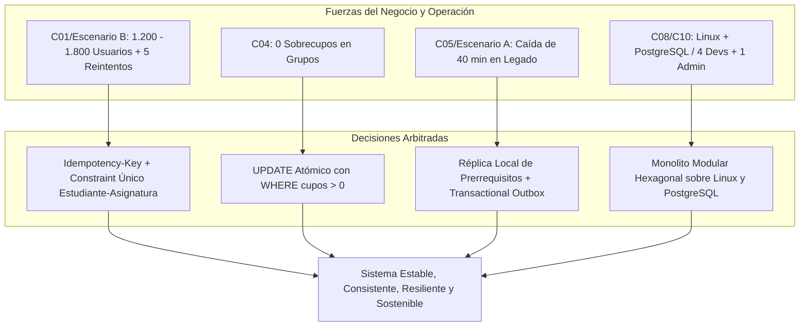

> **Estudiante:** David Mauricio Pérez Cordero | **Documento:** xxxxxxxx2

# Documento de Arbitraje y Negociación de Requisitos de Arquitectura
## Plataforma de Inscripción Académica (PIA) - Universidad de la Salle

---

## 1. Introducción y Propósito del Arbitraje

El diseño de la nueva **Plataforma de Inscripción Académica (PIA)** de la Universidad de la Salle involucra un ecosistema institucional de gran envergadura (aproximadamente 24.000 estudiantes, 1.100 docentes y 5 facultades). La sustitución operativa del sistema legado de más de 12 años exige conciliar requisitos funcionales y atributos de calidad que entran en conflicto directo bajo condiciones extremas de demanda y contingencias operativas.

El presente documento constituye el **Marco de Arbitraje Arquitectónico**, en el cual se evalúan, confrontan y priorizan formalmente los requisitos y condiciones de operación (`C01` a `C10`), determinando los compromisos (*trade-offs*) asumidos y las decisiones de diseño para garantizar la viabilidad técnica y operativa de la solución.

---

## 2. Inventario de Fuerzas en Conflicto y Condiciones de Operación

| Código | Condición / Requisito | Tipo de Fuerza | Implicación en el Sistema |
| :--- | :--- | :--- | :--- |
| **RF-01** | Consulta de asignaturas y grupos | Funcional | Operación de solo lectura de altísima frecuencia. |
| **RF-02** | Inscripción con validación de prerrequisitos, choques y cupos | Funcional | Operación transaccional crítica de lectura y mutación concurrente. |
| **RF-03** | Cancelación de asignaturas en fechas permitidas | Funcional | Mutación transaccional con restitución de cupo atómico. |
| **RF-04** | Consulta de estado de solicitudes e inscripciones | Funcional | Lectura de estado transaccional por usuario. |
| **RF-05** | Trazabilidad inmutable de operaciones | Funcional / Calidad | Registro de auditoría obligatorio por cada intento y mutación. |
| **RF-06** | Sincronización oficial con sistema académico legado | Integración | Dependencia con un sistema de más de 12 años fuente de verdad. |
| **C01** | 1.200 usuarios concurrentes en primeras horas (+50% en Escenario B: 1.800) | Carga / Concurrencia | Presión extrema sobre conexiones de BD, ancho de banda y CPU. |
| **C02** | p95 $\le$ 2 segundos en consultas de asignaturas | Rendimiento | Exige desacoplar las lecturas masivas del motor transaccional. |
| **C03** | Disponibilidad mensual $\ge$ 99,9% durante matrícula | Disponibilidad | Ventana máxima de inactividad de 43,8 minutos/mes. |
| **C04** | Cero sobrecupos en grupos académicos | Consistencia Estricta | Prohíbe tolerancia o consistencia eventual en cupos. |
| **C05** | Tolerancia a interrupciones del legado de hasta 40 min | Resiliencia / Aislamiento | La PIA no puede bloquearse ni caerse si el legado falla. |
| **C06** | RTO $\le$ 30 minutos (Recovery Time Objective) | Continuidad del Negocio | Tiempo máximo para restaurar el servicio tras falla total. |
| **C07** | RPO $\le$ 5 minutos (Recovery Point Objective) | Integridad de Datos | Máxima pérdida de transacciones tolerada en desastre. |
| **C08** | Infraestructura exclusiva Linux y PostgreSQL sin servicios de pago | Restricción Económica/Tec | Prohíbe Redis de pago, Kafka administrado o nubes comerciales. |
| **C09** | Seguridad, RBAC, auditoría y protección de datos | Seguridad / Cumplimiento | No se puede degradar la seguridad por optimizar velocidad. |
| **C10** | Equipo: 4 desarrolladores y 1 administrador de infraestructura | Capacidad Organizacional | Castiga arquitecturas distribuidas complejas (microservicios). |

---

## 3. Matriz de Tensiones y Arbitraje de Requisitos

A continuación se analizan los puntos de mayor fricción arquitectónica, estableciendo la postura de arbitraje del Arquitecto de Software:

### 3.1. Arbitraje 1: Consistencia Absoluta de Cupos (`C04`) vs. Rendimiento de Alta Concurrencia (`C01`, `C02`)

* **Tensión:** Garantizar 0 sobrecupos en grupos con alta demanda bajo 1.200 a 1.800 estudiantes concurrentes suele inducir bloqueos pesimistas a nivel de tabla o fila (`SELECT ... FOR UPDATE`), generando contención severa de bloqueos (*lock contention*), saturación del *connection pool* y degradación del tiempo de respuesta (violando el p95 $\le$ 2s).
* **Alternativas evaluadas:**
  1. *Bloqueo Pesimista Global:* Garantiza 0 sobrecupos pero colapsa ante 1.200 hilos compitiendo por los mismos grupos populares.
  2. *Reserva Asíncrona con Consistencia Eventual:* Mejora la latencia pero genera riesgo de sobrecupos si se encolan más solicitudes que la capacidad real.
  3. *Actualización Atómica Condicional por Fila (`UPDATE ... WHERE cupos > 0`):* Ejecuta la mutación de cupo en una sola sentencia SQL atómica respaldada por *row-level lock* ultracorto en PostgreSQL, apoyado por llaves de idempotencia (`Idempotency-Key`).
* **Veredicto del Arbitraje:** **Se prioriza la Consistencia Estricta (`C04`)** mediante **Actualización Atómica Condicional a nivel de fila**. El catálogo de consulta de materias se atiende desde memoria/caché local (cumpliendo `C02`), mientras que la reserva del cupo se ejecuta en milisegundos en PostgreSQL sólo para la fila específica del grupo.

---

### 3.2. Arbitraje 2: Disponibilidad $\ge$ 99,9% (`C03`) y Caídas del Legado de 40 min (`C05`) vs. Dependencia de Prerrequisitos en el Legado

* **Tensión:** El sistema legado es la fuente oficial de antecedentes académicos y prerrequisitos. Si la PIA realiza llamadas síncronas HTTP/SOAP/RPC al legado para validar si un estudiante puede inscribir una asignatura, una interrupción de 40 minutos en el legado (`C05`) paraliza las inscripciones en la PIA, violando la disponibilidad de 99,9% (`C03`, que tolera máximo 43,8 min de indisponibilidad en todo el mes).
* **Alternativas evaluadas:**
  1. *Consulta en línea con reintentos síncronos:* Descartada; propaga el fallo en cascada, agota el pool de conexiones del backend y causa denegación de servicio en PIA.
  2. *Validación ciega y corrección posterior:* Descartada; permitiría inscripciones inválidas que violan reglamentos académicos.
  3. *Pre-carga de Réplica Local de Prerrequisitos y Trazabilidad Asíncrona (Transactional Outbox):* Pre-sincronizar el catálogo, reglas y kárdex consolidado en una base local de lectura en PostgreSQL antes del inicio de la matrícula. Las inscripciones se validan contra esta réplica local y se confirman localmente como `INSCRITO_PENDIENTE_SINCRONIZACION_OFICIAL`, encolando el evento en la tabla Outbox para que un Worker lo sincronice al restaurarse el legado.
* **Veredicto del Arbitraje:** **Se arbitra a favor del Desacoplamiento Temporal**. El legado no participa en el camino crítico (*critical path*) de la transacción de inscripción del estudiante. Esto blinda a la PIA frente al Escenario A (caída de 40 minutos del legado), manteniendo el 100% de operatividad para consultar e inscribir.

---

### 3.3. Arbitraje 3: Escalabilidad y Resiliencia vs. Restricción de Stack (`C08`) y Capacidad de Equipo (`C10`)

* **Tensión:** Diseñar una arquitectura orientada a microservicios con brokers externos comerciales o múltiples bases de datos distribuidas facilitaría escalar módulos independientes, pero viola directamente la prohibición de servicios comerciales adicionales (`C08`) y desborda la capacidad operativa de un equipo de 4 desarrolladores y 1 administrador de infraestructura (`C10`).
* **Alternativas evaluadas:**
  1. *Arquitectura de Microservicios Distribuidos:* Requiere orquestación (Kubernetes), Service Mesh, distributed tracing, y gestión de fallas de red complejas; insostenible para 1 admin de infraestructura.
  2. *Monolito Tradicional no Estructurado:* Fácil de desplegar pero propenso a espagueti, alto acoplamiento con el sistema legado y dificultad para auditar cambios.
  3. *Monolito Modular con Arquitectura Hexagonal y Worker Integrado:* Despliegue en un único artefacto ejecutable sobre Linux (`systemd`/contenedores locales) con PostgreSQL unificado (esquemas separados para Matrícula, Auditoría, Outbox y Réplica de Legado).
* **Veredicto del Arbitraje:** **Se arbitra a favor de la Simplicidad Operativa y la Mantenibilidad (`C08`, `C10`)**. El Monolito Modular garantiza aislamiento lógico mediante interfaces y módulos bien delimitados, eliminando la latencia de red entre servicios y permitiendo que 4 desarrolladores y 1 administrador gestionen el ciclo de vida completo sin incurrir en costos de licencias comerciales.

---

### 3.4. Arbitraje 4: Alta Ráfaga de Reintentos (Escenario B) vs. Cero Inscripciones Duplicadas y Trazabilidad (`RF-05`, `C09`)

* **Tensión:** En momentos de alta concurrencia (1.800 usuarios) los estudiantes presionan repetidamente el botón de inscripción (hasta 5 reintentos automáticos o manuales). Si cada petición se procesa independientemente, se generan cupos duplicados para el mismo alumno, errores de concurrencia y sobrecarga inútil en la base de datos.
* **Alternativas evaluadas:**
  1. *Control en el Frontend (deshabilitar botón):* Insuficiente; no protege contra llamadas concurrentes automatizadas ni scripts.
  2. *Validación por software en memoria:* Volátil; propensa a condiciones de carrera si entran peticiones paralelas en distintos hilos del servidor.
  3. *Idempotencia de Extremo a Extremo (`Idempotency-Key` + Unique Constraints):* El cliente genera un UUID por intento de inscripción. El API valida la llave en un filtro/tabla de idempotencia en PostgreSQL con bloqueo transaccional. Además, la tabla `matricula.inscripcion` posee una restricción de unicidad compuesta `UNIQUE(estudiante_id, asignatura_id, periodo_academico)`.
* **Veredicto del Arbitraje:** **Se arbitra a favor de la Idempotencia Transaccional Rigurosa**. Las peticiones duplicadas retornan inmediatamente el resultado de la primera transacción exitosa sin volver a debitar cupos ni crear filas redundantes, reduciendo la carga del sistema en un 80% frente a ráfagas de 5 reintentos.

---

## 4. Síntesis de Decisiones Arbitradas

Este arbitraje sienta las bases formales para las especificaciones cuantitativas de la **Actividad 1**, los diagramas C4 de la **Actividad 2**, los registros **ADR de la Actividad 3**, las tácticas de la **Actividad 4** y el modelo de gobernanza de la **Actividad 5**.
